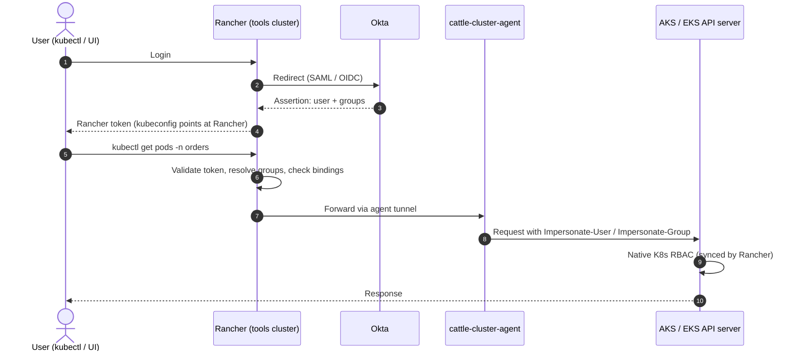
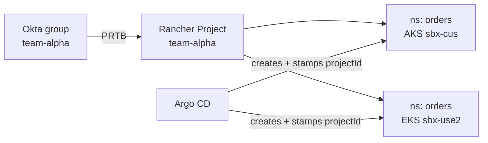

*This is a follow-up to [The Paved Road: Multi-Cloud GitOps for Platform Engineering](/posts/paved-road-gitops/). That article covered how changes reach clusters. This one covers how people reach them.*

## Deployments are solved, human access isn't

On the paved road, nobody runs `kubectl apply` against production. CI builds, Argo CD deploys, and Git is the only way a change gets into a cluster.

People still need to get *into* clusters, though. Developers read logs and `exec` into pods while debugging, SREs investigate incidents, and support checks what is running where. The paved-road article named "RBAC and tenancy boundaries" as one of the things real adoption still needs. This article picks that up.

Our clusters run on **AWS EKS and Azure AKS** across several environments and regions. The goal is one identity source and one RBAC model for every cluster, so that access works the same way regardless of cloud.

## Why unified access gets hard

- **The cluster count grows quickly.** Every environment × cloud × region is a cluster. Four environments × two clouds × three regions is already 24 clusters.
- **AKS and EKS authenticate differently.** AKS uses Microsoft Entra ID. EKS uses IAM and access entries. Each needs its own setup, kubeconfig flow, and RBAC mapping.
- **Joiners and leavers touch many systems.** Without a common layer, onboarding or offboarding a person means changes on both clouds and many clusters.
- **Audit is scattered.** Who accessed what lives in the Azure activity log, CloudTrail, and each cluster's API server audit log.

| Cloud | Native access | Mapping model |
|---|---|---|
| AKS | Microsoft Entra ID integration | Entra groups → Kubernetes RBAC or Azure RBAC |
| EKS | IAM Identity Center + access entries | Permission sets → IAM roles → access entries / Kubernetes RBAC |

The native approach gives you two identity providers, two mapping models, and two kubeconfig flows. Every new cluster, region, or tenant has to be wired up twice, and the two sides drift apart over time.

## Options

| Option | How it works | Trade-off |
|---|---|---|
| Native per-cloud | Entra ID for AKS, IAM Identity Center for EKS | No extra components, but two models to keep in sync |
| Generic OIDC | Cluster API servers trust one OIDC issuer (Okta, Dex, Pinniped); RoleBindings managed in Git | Uniform, but OIDC has to be configured on every cluster, and there is no central UI or audit |
| Access proxy | Teleport (or similar) brokers `kubectl` access | Strong auditing, but another product to license and run |
| **Rancher + central IdP** | Rancher authenticates through Okta and proxies access to every registered cluster | One login, one RBAC model, central audit, but Rancher is an extra critical component |

The rest of this article focuses on the last option, because it gives the most uniform result across clouds. Treat it as an **optional layer for human access** that you add when the fleet is big enough to justify it, not as a day-one requirement.

## Rancher as the human access layer


*One identity provider, one access layer, native Kubernetes RBAC on every cluster*

**What Rancher gives you:**

- One login (through Okta), and one kubeconfig and UI for all clusters on both clouds.
- One place to map groups to roles per cluster or per project.
- One audit trail of who accessed what through Rancher.
- No cloud-specific tooling (`az`, `kubelogin`, `aws eks`) for developers and support.

**What it doesn't do:**

- **It doesn't deploy.** Keep per-cluster Argo CD exactly as on the paved road.
- **It doesn't replace cloud IAM** for admins, Terraform, or CI.
- **It doesn't remove direct access.** You still need break-glass access through Entra and IAM.

## How it works



### Authentication

- Okta authenticates the user and returns their **group memberships** in the assertion. The Okta app needs a groups attribute, and Rancher's auth config must name that field.
- Rancher stores the identities as principals, for example `okta_group://team-alpha`.
- The user's kubeconfig points at **Rancher**, not at the cloud API server. Neither cloud's own IAM is involved in this path.

### Authorization

Rancher bindings attach an Okta principal to a role template at one of three scopes:

| Scope | Binding | Example |
|---|---|---|
| Rancher-wide | GlobalRoleBinding | Platform admins |
| Cluster | ClusterRoleTemplateBinding (CRTB) | SRE read-only on prod clusters |
| Project (a set of namespaces) | ProjectRoleTemplateBinding (PRTB) | Tenant team on its own namespaces |

### Enforcement

- Rancher's agent syncs these bindings into **native Kubernetes Roles and RoleBindings** on each downstream cluster.
- Rancher forwards each request through the agent tunnel with impersonation headers. The cluster's own API server makes the final RBAC decision, the same way on AKS and EKS.

## Mapping a project to an Okta group

A **Project** is a Rancher grouping of namespaces on a single cluster. A PRTB grants an Okta group a role on that project:

| PRTB field | Value |
|---|---|
| `projectName` | `<clusterId>:<projectId>` |
| `roleTemplateName` | `project-member`, `project-owner`, or `read-only` |
| `groupPrincipalName` | `okta_group://team-alpha` |

In Terraform, the [`rancher-register`](https://github.com/imkrupakar/platform-terraform/tree/main/modules/rancher-register) module gives every registered cluster one project per tenant, plus a PRTB for that tenant's group:

```hcl
tenants = {
  "team-alpha" = { group_principal_id = "okta_group://team-alpha" }
  "team-beta"  = { group_principal_id = "" } # creates the project with no binding
}
```

**Tie-in with Argo CD:** Argo CD creates each tenant's namespaces and stamps them with `field.cattle.io/projectId`, so they land in the right project automatically. As a result, an Okta group membership grants access to exactly the namespaces Argo CD created, on every cluster and cloud.



Rancher projects are per cluster. The same `team-alpha` project and PRTB are created on each cluster by the same Terraform map.

## What cloud IAM is still used for

| Concern | Mechanism |
|---|---|
| Provisioning (Terraform, CI) | Azure OIDC federation and AWS OIDC roles |
| Workload identity | AKS workload identity, EKS IRSA / Pod Identity (for example, AcrPull and secrets access) |
| Break-glass | Entra admin group on AKS and IAM access entry on EKS, for use when Rancher is unavailable |

A Rancher outage **does not stop deployments or running workloads**, because Argo CD reconciles independently of Rancher. It only affects human access through Rancher, and break-glass access covers that gap.

## Should you add Rancher?

**Consider it if:**

- You have roughly 10 or more clusters across both clouds, or expect to.
- Developers, SREs, or support need hands-on access (logs, exec, debugging) across many clusters.
- Security or compliance (SOC 2 or similar) wants one access and audit point.
- Onboarding and offboarding across two clouds is already slow.

**Skip it if:**

- Few people need cluster access, and Argo CD, dashboards, and logs cover their needs.
- Your platform team is small and can't take on running another critical system.
- You can solve access with Okta federation into Entra, AWS IAM Identity Center, and `RoleBinding`s in Git.

## How to adopt it safely

1. **Run it on a dedicated tools cluster,** highly available and not shared with workloads.
2. **Use it for human access only.** Argo CD, Terraform, and CI don't go through it. This keeps your recovery model, "rebuild from Terraform and Git", independent of Rancher.
3. **Import the clusters.** Don't have Rancher provision AKS or EKS, because Terraform already does.
4. **Use Okta as the source of truth.** Map Okta groups to Rancher roles.
5. **Keep break-glass access.** A small admin group keeps direct Entra and IAM access, so a Rancher outage doesn't lock you out.
6. **Manage Rancher config in Git** (role bindings, projects), with a small Argo CD on the tools cluster.
7. **Limit direct access afterwards.** If many people keep direct cloud access, Rancher's audit and boundaries are bypassed.

## Risks

- **Rancher becomes a critical, high-privilege system.** Its agents hold admin credentials on every cluster, so secure and patch it accordingly.
- **You add a second RBAC system.** Keep Rancher's generated objects separate from the RBAC you manage in Git.
- **A Rancher outage blocks the human path through it,** though not deployments.

## Recommendation

Start without Rancher while the fleet is small, and standardize on **Okta groups synced to Entra and AWS** from day one. Add Rancher when the cluster count or the volume of access requests makes the per-cloud approach painful.

The paved-road design makes that a low-risk addition later. Deployments, recovery, and workload identity never depend on Rancher, so adding it touches only human access.

## Reference implementation

- **Platform Terraform** (clusters, identity, Argo CD bootstrap, Rancher registration): [`imkrupakar/platform-terraform`](https://github.com/imkrupakar/platform-terraform)
- **Platform GitOps** (Argo CD control plane, tenant onboarding): [`imkrupakar/platform-gitops`](https://github.com/imkrupakar/platform-gitops)
- [Rancher: configuring Okta (SAML)](https://ranchermanager.docs.rancher.com/how-to-guides/new-user-guides/authentication-permissions-and-global-configuration/authentication-config/configure-okta-saml)
- [AKS: Microsoft Entra integration](https://learn.microsoft.com/en-us/azure/aks/enable-authentication-microsoft-entra-id)
- [EKS: access entries](https://docs.aws.amazon.com/eks/latest/userguide/access-entries.html)
