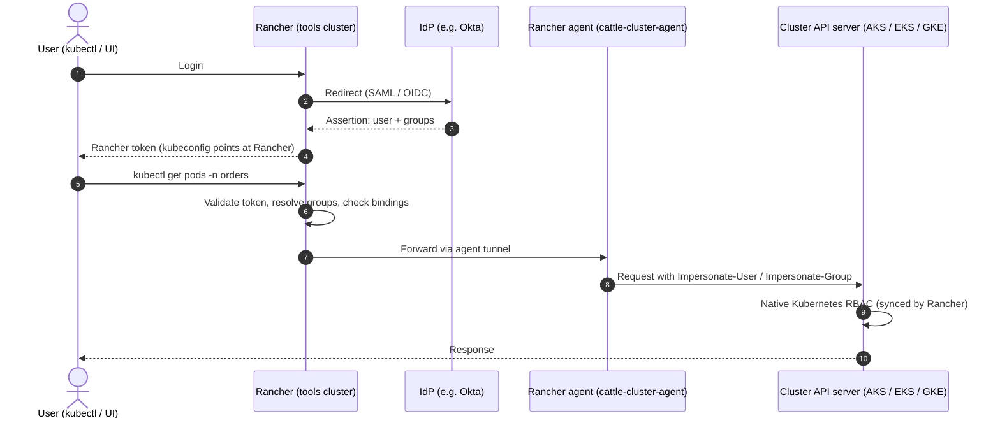
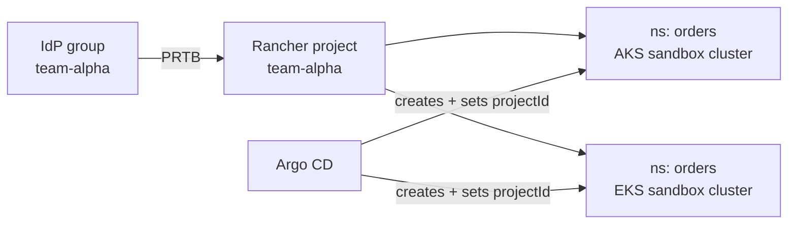

*This is a follow-up to [The Paved Road: Multi-Cloud GitOps for Platform Engineering](/posts/paved-road-gitops/). That article covered how changes reach clusters. This one covers how people reach them.*

## GitOps for deployments, Rancher for people

On the paved road, nobody runs `kubectl apply` against production. CI builds, Argo CD deploys, and Git is the only way a change gets into a cluster.

People still need to get *into* clusters, though. Developers read logs and `exec` into pods while debugging, SREs investigate incidents, and support checks what is running where. The paved-road article named "RBAC and tenancy boundaries" as one of the things real adoption still needs. This article picks that up.

Clusters rarely stay on one provider. A typical SaaS fleet ends up on several managed Kubernetes services, such as Amazon EKS, Azure AKS, and Google GKE, across several environments and regions. The goal is **one identity source and one RBAC model for every cluster**, so that access works the same way regardless of where a cluster runs.

The examples below use AKS and EKS, because that is what the reference implementation runs, but the approach applies to any mix of managed Kubernetes services.

## Why unified access gets hard

- **The cluster count grows quickly.** Every environment × provider × region is a cluster. Four environments × two providers × three regions is already 24 clusters.
- **Each provider authenticates differently.** AKS uses Microsoft Entra ID, EKS uses AWS IAM and access entries, and GKE uses Google Cloud IAM. Each needs its own setup, kubeconfig flow, and RBAC mapping.
- **Joiners and leavers touch many systems.** Without a common layer, onboarding or offboarding a person means changes on every provider and many clusters.
- **Audit is scattered.** Who accessed what lives in each provider's audit log (Azure activity log, AWS CloudTrail, Google Cloud Audit Logs) and in each cluster's API server audit log.

| Provider | Native access | Mapping model |
|---|---|---|
| AKS | Microsoft Entra ID integration | Entra groups → Kubernetes RBAC or Azure RBAC |
| EKS | IAM Identity Center + access entries | Permission sets → IAM roles → access entries / Kubernetes RBAC |
| GKE | Google Cloud IAM + Google Groups for RBAC | Google groups → Kubernetes RBAC or Cloud IAM roles |

Relying only on native access gives you one mapping model and one kubeconfig flow per provider. Every new cluster, region, or team has to be wired up once per provider, and the setups drift apart over time.

## Start with the identity provider you already have

Everything below assumes a single corporate **identity provider (IdP)** as the source of truth for users and groups. This article uses **Okta as the example**, but use whichever IdP your company already runs: Microsoft Entra ID, Okta, Google Workspace, Keycloak, or another SAML or OIDC provider. The pattern doesn't change, only the name of the integration.

The rule is simple: access is granted to **IdP groups**, never to individual users, and group membership is managed in the IdP. Clusters and tools only consume those groups.

## Options

| Option | How it works | Trade-off |
|---|---|---|
| Native per-provider | Each provider's own integration (Entra ID for AKS, IAM for EKS, Cloud IAM for GKE), federated from your IdP | No extra components, but one model per provider to keep in sync |
| Generic OIDC | Cluster API servers trust your IdP (directly, or through Dex or Pinniped) as an OIDC issuer; RoleBindings managed in Git | Uniform, but OIDC has to be configured on every cluster, and there is no central UI or audit |
| Access proxy | Teleport (or similar) brokers `kubectl` access | Strong auditing, but another product to license and run |
| **Rancher + your IdP** | Rancher authenticates through your IdP and proxies access to every registered cluster | One login, one RBAC model, central audit, but Rancher is an extra critical component |

The rest of this article focuses on Rancher, for teams that **want a common management portal across clusters and centralized RBAC**. Treat it as an **optional layer for human access** that you add when the fleet is big enough to justify it, not as a day-one requirement.

## Rancher as the human access layer

[Rancher](https://www.rancher.com/) is an open-source Kubernetes management platform from SUSE. It can import existing clusters from any provider and put them behind one UI, one login, and one RBAC model, without changing how those clusters are provisioned or deployed to.


*One identity provider, one access layer, native Kubernetes RBAC on every cluster (AKS and EKS shown as examples)*

**What Rancher gives you:**

- One login through your IdP, and one kubeconfig and UI for all clusters on every provider.
- One place to map IdP groups to roles per cluster or per project.
- One audit trail of who accessed what through Rancher.
- No provider-specific tooling (`az` and `kubelogin`, `aws eks`, `gcloud`) for developers and support.

**What it doesn't do:**

- **It doesn't deploy.** Keep per-cluster Argo CD exactly as on the paved road.
- **It doesn't replace cloud IAM** for admins, Terraform, or CI.
- **It doesn't remove direct access.** You still need break-glass access, an emergency path that goes straight through each provider's IAM.

## How it works

Rancher runs on a dedicated **tools cluster**, a small cluster that hosts platform tooling rather than application workloads. Each managed cluster runs a Rancher agent (`cattle-cluster-agent`) that keeps an outbound tunnel open to Rancher. Here is what happens when a developer runs `kubectl`:



### Authentication

- The IdP authenticates the user and returns their **group memberships** in the SAML assertion or OIDC token. The IdP application needs to send a groups attribute, and Rancher's auth config must name that field.
- Rancher refers to users and groups as principals. With Okta, a group looks like `okta_group://team-alpha`. The prefix depends on which IdP Rancher is configured with.
- The user's kubeconfig points at **Rancher**, not at the provider's API server. No provider IAM is involved in this path.

### Authorization

Rancher bindings attach an IdP group to a **role template** (Rancher's reusable role definition, which becomes a Kubernetes Role or ClusterRole on the cluster) at one of three scopes:

| Scope | Binding | Example |
|---|---|---|
| Rancher-wide | GlobalRoleBinding | Platform admins |
| Cluster | ClusterRoleTemplateBinding (CRTB) | SRE read-only on prod clusters |
| Project (a set of namespaces) | ProjectRoleTemplateBinding (PRTB) | Tenant team on its own namespaces |

### Enforcement

- Rancher's agent syncs these bindings into **native Kubernetes Roles and RoleBindings** on each cluster.
- Rancher forwards each request through the agent tunnel using Kubernetes **impersonation**: the request reaches the API server as the original user and their groups. The cluster's own API server makes the final RBAC decision, the same way on every provider.

## Mapping a project to an IdP group

On the paved road, each **tenant** is an application team with its own namespaces. In Rancher, a **Project** groups namespaces on a single cluster, so each tenant gets one project per cluster. A PRTB grants the tenant's IdP group a role on that project:

| PRTB field | Value |
|---|---|
| `projectName` | `<clusterId>:<projectId>` |
| `roleTemplateName` | `project-member`, `project-owner`, or `read-only` |
| `groupPrincipalName` | `okta_group://team-alpha` |

In Terraform, the [`rancher-register`](https://github.com/imkrupakar/platform-terraform/tree/main/modules/rancher-register) module registers each cluster with Rancher and creates one project per tenant, plus a PRTB for that tenant's group:

```hcl
tenants = {
  "team-alpha" = { group_principal_id = "okta_group://team-alpha" }
  "team-beta"  = { group_principal_id = "" } # creates the project with no binding
}
```

**Tie-in with Argo CD:** Argo CD creates each tenant's namespaces and annotates them with `field.cattle.io/projectId`, so they land in the right Rancher project automatically. As a result, one IdP group membership grants access to exactly the namespaces Argo CD created, on every cluster and provider.



The diagram simplifies one detail: Rancher projects are per cluster, so there is a `team-alpha` project on each cluster. The same Terraform map creates the project and PRTB on all of them, so they stay identical.

## What cloud IAM is still used for

| Concern | Mechanism |
|---|---|
| Provisioning (Terraform, CI) | OIDC federation from CI into each provider (for example, Azure workload identity federation and AWS IAM OIDC roles) |
| Workload identity | AKS workload identity, EKS IRSA or Pod Identity, GKE Workload Identity (for example, image pulls and secrets access) |
| Break-glass | A small admin group with direct access through each provider (for example, an Entra admin group on AKS and an IAM access entry on EKS), for when Rancher is unavailable |

A Rancher outage **does not stop deployments or running workloads**, because Argo CD reconciles independently of Rancher. It only affects human access through Rancher, and break-glass access covers that gap.

## Should you add Rancher?

**Consider it if:**

- You want a common management portal across clusters and centralized RBAC.
- You have roughly 10 or more clusters across providers, or expect to.
- Developers, SREs, or support need hands-on access (logs, exec, debugging) across many clusters.
- Security or compliance (SOC 2 or similar) wants one access and audit point.
- Onboarding and offboarding across providers is already slow.

**Skip it if:**

- Few people need cluster access, and Argo CD, dashboards, and logs cover their needs.
- Your platform team is small and can't take on running another critical system.
- You can solve access by federating your IdP into each provider's IAM and managing `RoleBinding`s in Git.

## How to adopt it safely

1. **Run it on a dedicated tools cluster,** highly available and not shared with workloads.
2. **Use it for human access only.** Argo CD, Terraform, and CI don't go through it. This keeps your recovery model, "rebuild from Terraform and Git", independent of Rancher.
3. **Import the clusters.** Don't have Rancher provision them, because Terraform already does.
4. **Use your IdP as the source of truth.** Map IdP groups to Rancher roles, and manage membership only in the IdP.
5. **Keep break-glass access.** A small admin group keeps direct access through each provider's IAM, so a Rancher outage doesn't lock you out.
6. **Limit direct access afterwards.** If many people keep direct cloud access, Rancher's audit and boundaries are bypassed.

## Risks

- **Rancher becomes a critical, high-privilege system.** Its agents hold admin credentials on every cluster, so secure and patch it accordingly.
- **A Rancher outage blocks the human path through it,** though not deployments.

## Recommendation

Start without Rancher while the fleet is small, and standardize on **groups in your existing IdP, federated into each provider** from day one. Add Rancher when you want a common management portal and centralized RBAC, or when the cluster count or volume of access requests makes the per-provider approach painful.

The paved-road design makes that a low-risk addition later. Deployments, recovery, and workload identity never depend on Rancher, so adding it touches only human access.

## Reference implementation

- **Platform Terraform** (clusters, identity, Argo CD bootstrap, Rancher registration): [`imkrupakar/platform-terraform`](https://github.com/imkrupakar/platform-terraform)
- **Platform GitOps** (Argo CD control plane, tenant onboarding): [`imkrupakar/platform-gitops`](https://github.com/imkrupakar/platform-gitops)
- [Rancher: authentication configuration](https://ranchermanager.docs.rancher.com/how-to-guides/new-user-guides/authentication-permissions-and-global-configuration/authentication-config)
- [AKS: Microsoft Entra integration](https://learn.microsoft.com/en-us/azure/aks/enable-authentication-microsoft-entra-id)
- [EKS: access entries](https://docs.aws.amazon.com/eks/latest/userguide/access-entries.html)
- [GKE: Google Groups for RBAC](https://cloud.google.com/kubernetes-engine/docs/how-to/google-groups-rbac)
