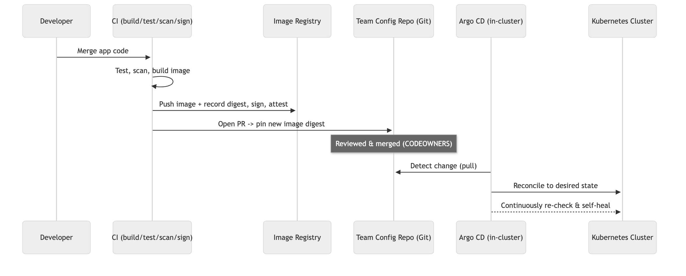
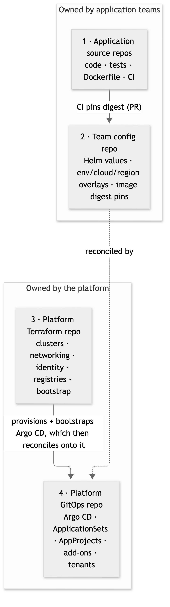
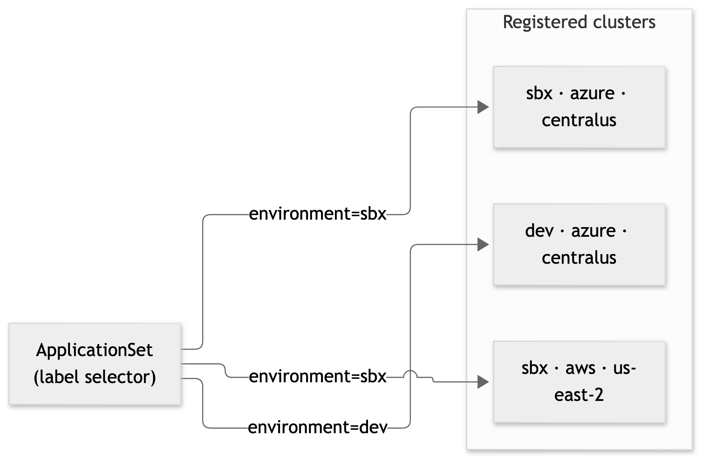

# The Paved Road: Multi-Cloud GitOps for Platform Engineering

*Platform engineering turns complex infrastructure and deployment into a standardized, self-service experience, so teams build, deploy, and scale consistently across clouds, regions, and environments.*

## Compute isn't a platform

Most internal platforms stop at compute. The platform team provisions the cloud accounts, the networking, and a Kubernetes cluster, hands it over, and says: *you deploy and operate your apps on it.*

That sounds empowering. In practice it means **every team reinvents application delivery.** Each one writes its own deployment pipelines, wires its own cluster credentials, invents its own folder layout for environment config, and improvises its own promotion and rollback logic. Multiply that by every team, every environment, every cloud, and every region, and you get:

- **Duplicated delivery logic:** the same deployment plumbing, written N slightly different ways.
- **Inconsistent configuration:** no two teams structure their environment values the same way.
- **Credential sprawl:** push-based pipelines hold cluster-admin-grade credentials, because they run `kubectl apply` directly.
- **No continuous reconciliation:** once a pipeline finishes, nothing keeps the cluster matching what's in Git. Manual "just this once" changes during an incident quietly become permanent drift.
- **Add-on drift:** shared add-ons installed as Terraform Helm releases are only checked when Terraform runs, so live state diverges between applies.
- **Fragile recovery:** rebuild a cluster and you have to re-run every team's bespoke process to get back to a known state.
- **Expensive onboarding:** a new app, team, region, or cloud is a *project*, not a *pull request*.

And this problem is getting bigger, not smaller. Enterprises are increasingly moving away from standardizing on a single cloud provider. They spread workloads across AWS, Azure, and GCP for resilience, pricing leverage, regulatory requirements, or because of M&A and legacy footprints. Every one of the pain points above doesn't just repeat per team; it repeats per cloud.

The cognitive load lands squarely on application teams who just want to ship features. The platform gave them raw material and left them to build the factory.

This article is about the alternative: a **paved road**.

## Platform engineering is a product, not a pile of compute

The job of a platform engineering team isn't to hand out clusters and wish people luck. It's to build and maintain an **Internal Developer Platform**: a set of **golden paths** (templates, pipelines, charts, and policies) that teams adopt *by default*, with **governance and compliance baked into the path itself.**

Teams shouldn't read a wiki and hope they got security right. They should consume the artifact the platform team maintains, and get the guardrails for free. That's the core idea behind every serious treatment of the discipline:

- The **CNCF Platforms white paper** frames platforms as things that "embed governance and controls in templates, patterns, and capabilities," existing to **reduce cognitive load** and reduce security and regulatory risk by *governing capabilities*.
- **Golden paths / paved roads** are the supported, opinionated, well-lit route that is the *easiest* way to do the right thing.
- **Team Topologies** calls this *platform-as-a-product*: the platform team's customers are the stream-aligned application teams.
- **GitOps** supplies the delivery mechanism: declarative, versioned, pulled automatically, and **continuously reconciled**.

Here's the real test of whether a platform is actually *paved*:

> **How hard is it to onboard a new app, a new region, a new cloud, or a new team? On a paved platform, that's a file and a PR. If it's a project, the road isn't paved yet.**

Everything below is in service of passing that test.

## The core shift: CI builds, GitOps deploys

The single most important move is to **separate building from deploying**.

In the old push-based model, a CI pipeline builds the image *and* reaches into the cluster to apply it. That's why CI ends up holding cluster credentials, and why nothing reconciles state afterward.

In the GitOps model, responsibilities split cleanly:

- **CI builds, tests, scans, signs, and publishes** an immutable image, then **opens a pull request** that updates the desired state in Git. It never touches the cluster.
- **An in-cluster GitOps controller (Argo CD) pulls** the approved desired state from Git and **continuously reconciles** the cluster to match it.



*CI never touches the cluster. It builds, signs, and opens a PR. Argo CD pulls the approved state and reconciles.*

Why this matters:

- **No cluster write-credentials in CI.** CI needs to push an image and open a PR, not administer Kubernetes. The blast radius of a compromised pipeline shrinks dramatically.
- **Continuous reconciliation and self-heal.** The controller constantly compares live state to Git and corrects drift, instead of trusting that a one-shot pipeline left things correct.
- **Git as the audit trail.** Every change is a reviewed commit. Who changed what, when, and why is just `git log`.
- **Recovery is boring.** Rebuild a cluster, point the controller at Git, and the desired state flows back in.

**CI/CD isn't being removed. It's being refocused.** CI still owns producing and verifying trustworthy artifacts. GitOps takes over deployment and reconciliation. Your CI system can be anything (GitHub Actions, GitLab CI, Buildkite); the reference implementation uses GitHub Actions, but nothing in the model depends on it.

## The four-layer repository model

Clean delivery starts with clean ownership. Split repositories by *responsibility*, not by convenience, into four layers:



*Two repos per side. Application teams own source and config; the platform owns infrastructure and the GitOps control plane.*

**1. Application source**
- Responsibility: develop and build artifacts.
- Owner: the application team.
- Contents: source, tests, Dockerfile, build and scan definitions.

**2. Team configuration**
- Responsibility: declare *what* the team deploys and its desired config per target.
- Owner: the application team, within guardrails.
- Contents: Helm values, image digest pins, env/cloud/region overlays.

**3. Platform Terraform**
- Responsibility: provision cloud and cluster foundations.
- Owner: the infrastructure / cloud platform team.
- Contents: clusters (AKS/EKS), networking, identity, registries, bootstrap.

**4. Platform GitOps**
- Responsibility: govern *what the controllers reconcile*.
- Owner: platform engineering.
- Contents: Argo CD root app, ApplicationSets, AppProjects, cluster labels, shared add-ons, tenant onboarding.

Two supporting platform-owned assets round out the paved road. They are separate repos, not folders in the four above:

- **A golden Helm chart repo:** the standard, opinionated service chart every app renders through.
- **A shared CI workflow repo:** reusable build, sign, promote, and validate workflows teams *call*, not copy.

**One critical boundary:** the platform GitOps repo is a *governance* control plane. It is **not** a repo that every team must open a PR against for every release. Each team's own config repo stays the source of truth for *that team's* workloads. The platform repo defines the framework; the teams drive their own desired state through it.

## Layered configuration: define only what differs

A team's config repo should let them express differences *only at the level where they occur*. A base `values.yaml` holds service defaults; environment, cloud, and region files override only what changes for that target. **The deepest matching layer wins.**

```
team-alpha-gitops/
└── apps/
    └── orders-api/
        ├── base/
        │   └── values.yaml                 # service defaults
        └── envs/
            ├── dev/
            │   └── values.yaml             # dev overrides
            └── sbx/
                ├── values.yaml             # sandbox-wide overrides
                ├── aws/
                │   ├── values.yaml         # AWS-specific
                │   └── us-east-2/
                │       └── values.yaml     # region-specific
                └── azure/
                    ├── values.yaml         # Azure-specific
                    └── centralus/
                        └── values.yaml     # region-specific
```

Resolution is a simple precedence chain (**base → environment → cloud → region**), so sandbox-wide settings, AWS-vs-Azure differences, and per-region tweaks each live exactly once, at the right altitude. No copy-pasted value trees per cloud.

A leaf file stays tiny, because it only pins what's unique to that target, most importantly the **immutable image digest**:

```yaml
# apps/orders-api/envs/sbx/azure/centralus/values.yaml
image:
  repository: sbxacrplatform.azurecr.io/orders-api
  digest: "sha256:3f8a...e21c"   # built once by CI, promoted by digest
```

This is the heart of **build-once / promote-many**: CI builds and signs an image *one time*, and promotion to the next environment or region is a reviewed PR that reuses *the same digest*, never a rebuild. What you tested is bit-for-bit what you ship.

## The paved-road components

Repository separation defines ownership, but ownership alone isn't a paved road. The platform team has to ship **reusable components and a supported contract** so teams never design delivery machinery themselves:

- **Application scaffold:** starter repo structure, Dockerfile conventions, CI wiring, service metadata.
- **Reusable CI workflows:** central build, test, scan, publish, sign, and config-update workflows teams *call*.
- **Golden Helm chart:** approved probes, resource requests and limits, security context, workload-identity service account, progressive delivery, observability conventions.
- **Config template:** a supported team-config structure, schema, and worked examples.
- **Argo CD framework:** root app, ApplicationSets, AppProjects, repo registration, label-based cluster selection.
- **Tenant baseline:** namespace, quotas, limit ranges, baseline RBAC, network policies.
- **Release promotion:** build-once/promote-many, digest pinning, reviewed promotion PRs, progressive rollout and rollback.
- **Validation and policy:** schema validation, Helm lint/template, and policy checks that *reject bad config before merge*.

The golden chart is where governance becomes invisible-by-default: a team sets a handful of values, and gets security context, health probes, a pod disruption budget, an HPA, a workload-identity service account, and externalized secrets without knowing the YAML behind any of it. **That's governance in the path, not in a wiki.**

Teams should be *thin consumers*. If anyone is copying a workflow file or hand-authoring an ApplicationSet to ship a service, the road isn't paved there yet.

## Platform add-ons through GitOps

Shared add-ons (External Secrets, a service mesh, progressive-delivery controllers, observability agents, policy engines) should follow the *same* desired-state model as tenant apps. Terraform bootstraps only the cluster foundation and the GitOps entry point; day-2 add-on lifecycle moves to Argo CD after a clear handoff.

- **Add-on catalog:** each approved add-on with its owner, chart/source, target cluster labels, sync order, and a **per-cluster version pin**.
- **Promotion path:** validate an add-on change in a canary/sandbox cluster, allow soak time, then promote through dev → staging → production via reviewed Git changes.
- **Safe migration:** move Terraform-managed Helm releases to GitOps **one add-on at a time**. Terraform and Argo CD must never manage the same release simultaneously.

The payoff is that add-ons get the same continuous reconciliation, self-heal, and staged rollout as applications, with no more silent drift between infrastructure applies.

## Onboarding: a file and a PR

This is the test the whole framework is built to pass. Once the underlying infrastructure exists, onboarding is **declarative**: add or edit a small set of files, open a reviewed PR, done.

- **New app (existing team):** add a service entry and a config leaf in the team's config repo. Platform templates expose it to Argo CD; CI builds and the controller deploys on merge.
- **New team:** create a config repo from the approved template. ApplicationSets create the tenant's project and baseline namespace resources.
- **New environment:** declare it in platform config with env-specific settings. Targeting rules discover it and reconcile the right shared and tenant workloads.
- **New region:** provision the cluster via Terraform, then register its cloud/region/environment metadata. The cluster bootstraps Argo CD, discovers its config from labels, and reconciles.
- **New cloud:** reuse or implement the cloud's Terraform module and identity/registry integration, then register the cluster. The *same* GitOps templates and golden chart serve it, with no parallel tree.

**An honest caveat:** "a file away" refers to the *application and GitOps onboarding* steps. A genuinely new region or cloud still needs real infrastructure (network connectivity, identity, registries, DNS, security integration) provisioned and approved first. The framework makes the delivery layer declarative and repeatable *once those prerequisites are met.* It doesn't conjure a VPC from a YAML file.

## Multi-cloud and multi-region, without copy-paste

The same team config repo and the same golden chart should serve both AKS and EKS. Cloud differences hide behind supported chart values or small adapters, never parallel copies of every team's config.

The mechanism is **label-driven targeting**. Every cluster is registered with a consistent metadata contract: at minimum `environment`, `cloud`, and `region`, plus optional labels for product, tenant eligibility, or compliance boundary. ApplicationSets use those labels to decide what goes where:



*One ApplicationSet, one label selector. It doesn't care which cloud or region a matching cluster happens to be in.*

Two properties make this safe at scale:

- **Per-cluster version pins.** Each cluster pins its own chart and add-on versions, so a release moves through *sandbox → development → staging → production* in a controlled, staggered way.
- **Bounded blast radius.** You explicitly avoid the "one commit rolls to every cluster in a stage at once" trap. Each hop is a reviewed PR against one target: canary first, soak, then promote.

## Security and the supply chain

GitOps changes *where* trust lives, so the controls move with it:

- **Least-privilege everywhere.** Application CI needs to publish an image and open a PR, nothing more. The GitOps controller gets **read-only** access to just the repos and paths it reconciles, with scoped, rotated credentials.
- **Git is now a control plane, so protect it like one.** Branch protection, required reviews, `CODEOWNERS`, required validation checks, and audit retention on the desired-state repos.
- **Protect the artifacts.** Image signing, provenance/attestation, vulnerability scanning, and **digest pinning** are complementary. GitOps does not make an untrusted image safe.
- **Externalize secrets.** No plaintext secrets in Git. Use the External Secrets Operator (or equivalent) to pull from the cloud secret manager via workload identity.
- **Define reconciliation boundaries.** Don't let the controller fight other controllers. Configure ownership and ignore-difference rules so Argo CD doesn't continuously overwrite fields owned by an HPA or a cloud load-balancer controller.

## Responsibility boundaries

Paved roads work because *everyone knows what they own.* Three roles, cleanly separated:

- **Cloud accounts, network, cluster lifecycle**
  - Infrastructure / cloud platform: owns and provides.
  - Platform engineering: consumes agreed interfaces, documents prerequisites.
  - Application team: consumes the platform.
- **Argo CD and the GitOps control plane**
  - Infrastructure / cloud platform: agreed bootstrap and cluster integration.
  - Platform engineering: defines and maintains the framework, templates, and policies.
  - Application team: doesn't administer the shared control plane.
- **App source and CI tests**
  - Infrastructure / cloud platform: not responsible.
  - Platform engineering: provides reusable workflow templates.
  - Application team: owns code, tests, and build inputs.
- **App deployment config**
  - Infrastructure / cloud platform: provides cluster capability.
  - Platform engineering: defines the schema, golden chart, and validation.
  - Application team: owns service values and desired config.
- **Deployment reconciliation**
  - Infrastructure / cloud platform: provides cluster availability.
  - Platform engineering: operates the paved-road GitOps framework.
  - Application team: changes desired state via reviewed PRs.
- **Runtime and service health**
  - Infrastructure / cloud platform: provides infra and cluster health.
  - Platform engineering: provides standard observability patterns.
  - Application team: owns SLOs, alerts, and incident response.

## What this is, and what it isn't

Be honest about maturity. A framework like this can be **validated end-to-end as a proof of concept**: Terraform provisioning AKS and EKS clusters across regions, Argo CD self-managing from Git, image build and signing, same-digest promotion across environments and registries, label-driven ApplicationSets, per-cluster version pins, and tenant namespace deployment all working together.

That proves the architecture is *viable*. It is **not** the same as a turnkey production platform. Real adoption still needs hardened identities and registries, production secret integration, RBAC and tenancy boundaries, policy enforcement, observability, and operational runbooks. Placeholder names and sandbox resources get replaced with approved production integrations. Treat the POC as *evidence*, then harden and pilot with one team before you scale.

## Reference implementation and further reading

A complete, generic reference implementation of everything above is public:

- **Platform Terraform** (clusters, networking, identity, registries, Argo CD bootstrap): [imkrupakar/platform-terraform](https://github.com/imkrupakar/platform-terraform)
- **Platform GitOps** (Argo CD control plane, ApplicationSets, AppProjects, add-ons, tenant onboarding): [imkrupakar/platform-gitops](https://github.com/imkrupakar/platform-gitops)
- **Golden Helm charts** (the opinionated, governed service chart): [imkrupakar/golden-helm-charts](https://github.com/imkrupakar/golden-helm-charts)
- **Shared CI workflows** (reusable build, sign, promote, validate): [imkrupakar/platform-actions](https://github.com/imkrupakar/platform-actions)
- **Example team config** (layered values and promotion): [imkrupakar/team-alpha-gitops](https://github.com/imkrupakar/team-alpha-gitops)
- **Example application** (source and CI only, no manifests): [imkrupakar/orders-api](https://github.com/imkrupakar/orders-api)

Foundational reading:

- [OpenGitOps principles](https://opengitops.dev/): declarative, versioned, pulled, continuously reconciled.
- [CNCF Platforms white paper](https://tag-app-delivery.cncf.io/whitepapers/platforms/): platforms, golden paths, cognitive load.
- [Argo CD best practices: config vs. source repos](https://argo-cd.readthedocs.io/en/stable/user-guide/best_practices/#separating-config-vs-source-code-repositories).
- [Team Topologies](https://teamtopologies.com/): platform-as-a-product, thinnest viable platform.
- [Paved roads / golden paths](https://www.thoughtworks.com/radar/techniques/paved-roads).

## The point of a paved road

A cluster is raw material. A **paved road** is a product: the supported, secure, well-lit path that makes the right way the *easy* way. When CI builds and GitOps deploys, when configuration is layered instead of duplicated, when governance lives in a golden chart instead of a wiki, and when onboarding a new app, region, cloud, or team is genuinely *a file and a PR*, application teams stop maintaining delivery plumbing and start shipping outcomes.

That's the paved road for a multi-cloud GitOps strategy: one set of templates, one control plane, consistent governance, regardless of which cloud or region a team ships to.
